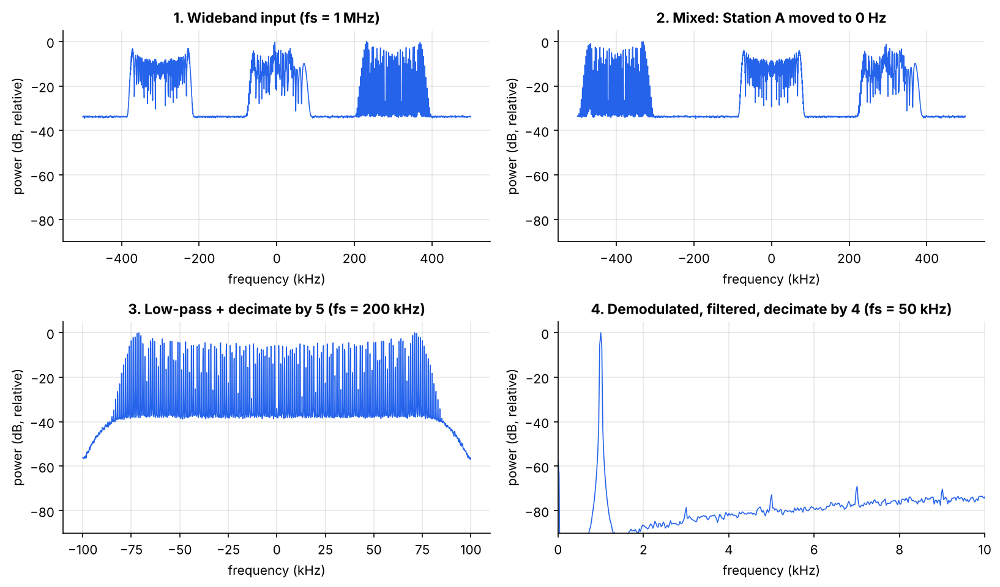
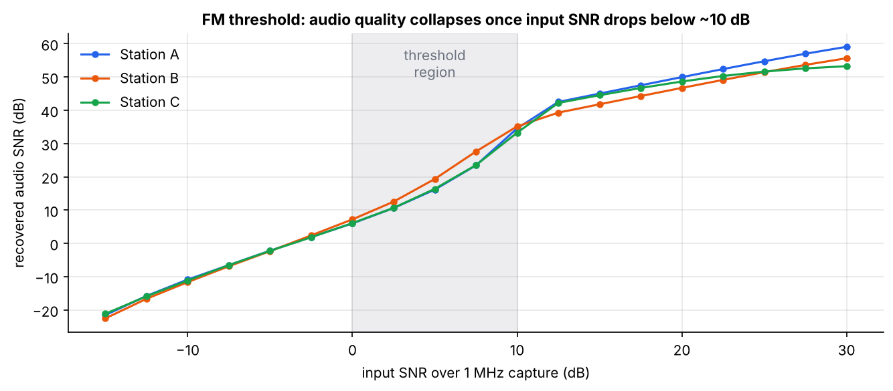
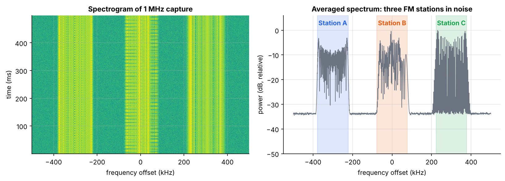
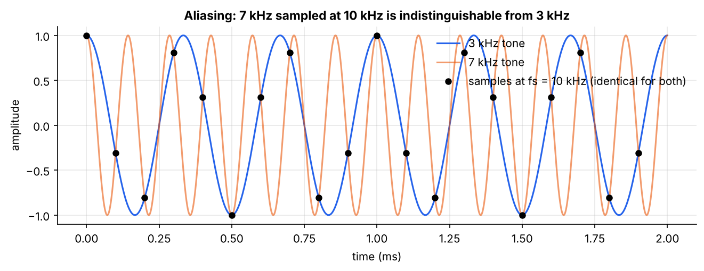
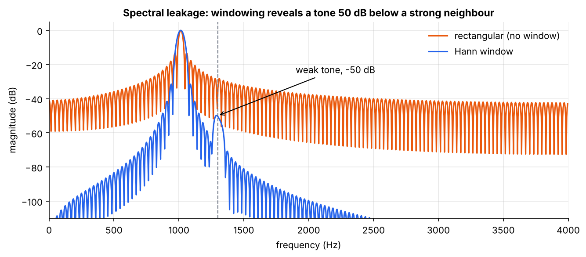
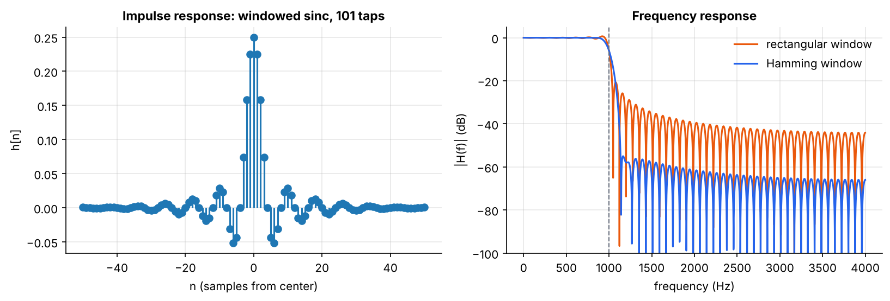
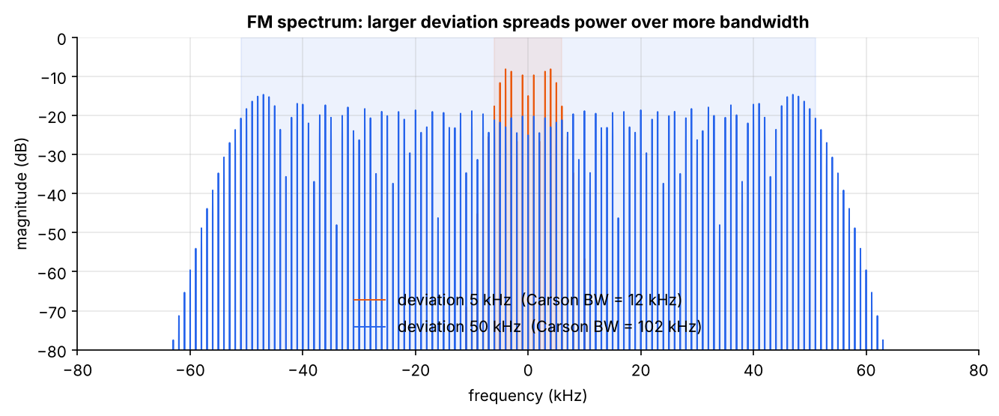

# DSP Fundamentals → Software-Defined FM Receiver

A pure-Python digital signal processing project that builds the core DSP toolkit
from first principles (sampling, the DFT, windowing, FIR filter design,
decimation, AM/FM modulation) and then uses it to build a **software-defined
radio receiver** that pulls three FM stations out of a single wideband I/Q
capture.

No hardware needed. Every signal is synthesized, every algorithm is written out
in NumPy, and each one is verified against theory or a reference library in the
test suite.



## Results

**Three stations recovered from one 1 MHz capture** (input SNR 20 dB):

| Station | Offset | Tones sent (Hz) | Tones detected (Hz) | Audio SNR |
|---|---|---|---|---|
| A | −300 kHz | 1000 | 1000 | 50.0 dB |
| B | 0 kHz | 600, 2400 | 600, 2400 | 46.8 dB |
| C | +300 kHz | 3000 | 3000 | 48.7 dB |

**FM threshold effect.** Sweeping input noise shows the classic FM behavior:
above threshold, audio SNR is far better than input SNR (FM trades bandwidth
for noise immunity); below about 10 dB input SNR, the demodulator breaks down
and that advantage disappears.



## How the receiver works

An SDR delivers complex baseband samples covering a wide slice of spectrum.
To listen to one station:

| Step | Operation | Sample rate |
|---|---|---|
| 1. Tune | Multiply by `exp(-j2π·f_offset·n/fs)` to shift the station to 0 Hz | 1 MHz |
| 2. Select | 101-tap windowed-sinc low-pass (90 kHz), keep every 5th sample | 1 MHz → 200 kHz |
| 3. Demodulate | Polar discriminator: `angle(x[n]·conj(x[n−1]))` gives instantaneous frequency | 200 kHz |
| 4. Audio | Low-pass to 15 kHz, keep every 4th sample | 200 kHz → 50 kHz |

The channel filter's 90 kHz cutoff comes from Carson's rule: a 75 kHz
deviation carrying audio up to 3 kHz occupies about 2(75 + 3) = 156 kHz.



## Fundamentals covered

| Example | Concept | Key result |
|---|---|---|
| `01_sampling_aliasing.py` | Nyquist, frequency folding | 7 kHz sampled at 10 kHz is identical to 3 kHz |
| `02_fft_windowing.py` | DFT from its definition, bin resolution, spectral leakage | Hann window reveals a tone 50 dB below its neighbor |
| `03_fir_filter.py` | Windowed-sinc FIR design, linear phase, filtering | ≥56 dB stopband; 3 kHz interferer removed |
| `04_modulation.py` | AM envelope detection, FM, Carson's rule | Exact round-trip demodulation |
| `05_fm_receiver.py` | Full receiver chain + noise analysis | 3 stations recovered; FM threshold measured |

| | |
|---|---|
|  |  |
|  |  |

## Quick start

```bash
pip install -r requirements.txt
python run_all.py          # runs all five examples, regenerates figures/
python -m pytest           # 20 tests
```

Or run one example: `python examples/05_fm_receiver.py`

## Project layout

```
dsp/
  signals.py      tones, noise at a target SNR, SNR measurement
  sampling.py     aliasing, downsampling, decimation
  spectrum.py     direct DFT, windowed spectrum, Welch PSD
  filters.py      windowed-sinc FIR design, filtering, frequency response
  modulation.py   AM and FM modulators and demodulators
  receiver.py     wideband scene synthesis and the FM receiver chain
examples/         one runnable script per topic, each saves figures
tests/            unit tests against theory and SciPy reference designs
```

## Verification

The test suite checks each block independently:

- Direct DFT matches `np.fft.fft`
- The windowed-sinc design matches `scipy.signal.firwin` to 1e-12
- Filter passband ripple < 0.1 dB, stopband < −50 dB, coefficients symmetric (linear phase)
- Decimation suppresses a tone that plain downsampling aliases
- FM and AM round trips are exact without noise; FM envelope is constant
- The receiver recovers every station's tones above threshold and degrades below it

## Possible extensions

- Pre-emphasis / de-emphasis (75 µs) as used in real broadcast FM
- Stereo decoding from the 19 kHz pilot and 38 kHz subcarrier
- Digital modulation (BPSK/QPSK) with pulse shaping and bit-error-rate curves
- Running the same receiver on recorded I/Q files from a real SDR
